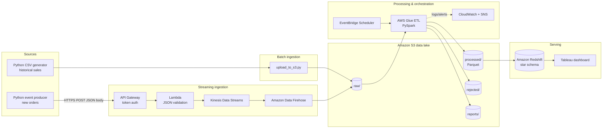

# AWS Real-Time & Batch Sales Analytics Platform

An end-to-end data engineering project on AWS. It collects sales transactions from a fictional
online retailer, keeps the original data in an S3 data lake, cleans and validates it with
AWS Glue (PySpark), loads it into an Amazon Redshift star schema, and serves business
dashboards in Tableau. A streaming path (API Gateway → Lambda → Kinesis → Firehose) adds
real-time orders on top of the batch pipeline.


> **Status:** 🚧 In progress — Phase 0/1. See the [roadmap](#roadmap).

---

## Business questions

| # | Question | Answered by |
|---|----------|-------------|
| 1 | What is the total revenue by day? | `sql/analytics_queries.sql` #1 |
| 2 | Which products generate the most revenue? | #2 |
| 3 | Which cities have the most orders? | #3 |
| 4 | How many orders arrive in real time? | #4 (streaming) |
| 5 | How many transactions are invalid or duplicated? | Glue run reports in `s3://…/reports/` |
| 6 | How does today compare with previous days? | #5 |

## Architecture



- **S3** is the central data lake (source of truth, replayable).
- **Redshift** is the analytical warehouse. It is provisioned late (Phase 4) to keep costs down.
- **DynamoDB** is added only if needed (e.g. processed-event IDs for idempotency).

More detail: [docs/architecture.md](docs/architecture.md). An earlier reference design
(EC2 scraper → Kinesis → S3 → Lambda → Glue → Athena/Redshift → QuickSight) is kept in
[docs/images/reference-architecture.jpg](docs/images/reference-architecture.jpg).

### S3 layout

```
s3://<bucket>/
├── raw/sales/ingestion_date=YYYY-MM-DD/sales.csv      # original files, never modified
├── raw/streaming/YYYY/MM/DD/HH/…                      # Firehose output
├── processed/sales/year=YYYY/month=MM/*.parquet       # cleaned, typed, de-duplicated
├── curated/sales/                                     # analytics-ready aggregates
├── rejected/sales/ingestion_date=YYYY-MM-DD/          # failed rows + rejection_reason
└── reports/sales/ingestion_date=YYYY-MM-DD/           # row-count reconciliation per run
```

### Data model (Redshift star schema)

```
            dim_date
               │
dim_product ── fact_sales ── dim_city
```

`fact_sales` grain = one order line. `revenue = quantity × unit_price`. See
[sql/create_tables.sql](sql/create_tables.sql).

## Tech stack

| Layer | Services / tools |
|-------|------------------|
| Ingestion | Python, Amazon S3, API Gateway, AWS Lambda, Kinesis Data Streams, Amazon Data Firehose |
| Processing | AWS Glue (PySpark), Glue Data Catalog |
| Orchestration & monitoring | Amazon EventBridge Scheduler, CloudWatch, SNS |
| Warehouse | Amazon Redshift |
| BI | Tableau |
| Engineering | Git, GitHub Actions (CI + CD), pytest, ruff |

## Project structure

```
aws-sales-data-platform/
├── src/
│   ├── generate_data.py        # synthetic sales CSV (with optional bad rows + duplicates)
│   ├── upload_to_s3.py         # upload CSV to raw/ zone
│   └── validation.py           # shared order validation rules
├── glue_jobs/
│   └── transform_sales.py      # Glue PySpark ETL: validate, dedupe, Parquet, reports
├── lambda_functions/
│   └── ingest_order/handler.py # API → validate JSON → Kinesis
├── sql/
│   ├── create_tables.sql       # Redshift star schema
│   └── analytics_queries.sql   # business questions
├── tests/                      # pytest unit tests
├── infra/                      # infrastructure as code (Phase 7)
├── docs/                       # architecture, setup guide, diagrams
├── data/                       # generated locally, git-ignored
└── .github/workflows/          # ci.yml (lint + test), deploy.yml (CD to AWS)
```

## Getting started (Windows)

Full setup guide: [docs/setup-windows.md](docs/setup-windows.md).

```powershell
git clone https://github.com/soumikbelel3-commits/aws-sales-data-platform.git
cd aws-sales-data-platform

python -m venv .venv
.venv\Scripts\Activate.ps1
pip install -r requirements-dev.txt

# 1. Generate 1,000 orders (plus a few invalid rows and duplicates)
python src/generate_data.py

# 2. Run the tests
pytest

# 3. Upload to your S3 bucket (needs an AWS CLI profile)
copy .env.example .env   # then edit values
python src/upload_to_s3.py --bucket <your-bucket> --profile sales-dev
```

## Roadmap

- [ ] **Phase 0 — AWS environment:** MFA, billing budget + alerts, IAM identity, one region, local tools
- [ ] **Phase 1 — Data lake:** private encrypted S3 bucket, generate sample data, upload to `raw/`
- [ ] **Phase 2 — Batch ETL:** Glue/PySpark job — validate, dedupe, revenue, Parquet, rejected rows, reconciliation report
- [ ] **Phase 3 — Automation:** EventBridge Scheduler → Glue, CloudWatch logs/metrics, SNS failure alerts
- [ ] **Phase 4 — Warehouse:** Redshift star schema, idempotent loads (staging + MERGE), business SQL
- [ ] **Phase 5 — Dashboard:** Tableau — revenue trend, top products, city breakdown, order status
- [ ] **Phase 6 — Streaming:** API Gateway + Lambda + Kinesis + Firehose → S3, event producer script
- [ ] **Phase 7 — Production finish:** data-quality reports, failure handling, least-privilege IAM, IaC, CD pipeline, cost docs

## Requirements & acceptance criteria

| Requirement | Implementation |
|-------------|----------------|
| Connect client to API | API Gateway HTTPS endpoint, Python producer script |
| Security with tokens | API Gateway JWT / Lambda authorizer; no unauthenticated writes |
| JSON validation | `src/validation.py` used by the ingestion Lambda; 400 with details on failure |
| Request body, not query string | Lambda only reads the JSON body; requires `Content-Type: application/json` |
| Lambda error handling | 400 / 415 / 500 responses, structured logging, retry-safe (`order_id` is the dedupe key) |
| IAM least privilege | One role per service, scoped to specific buckets/streams; no `*FullAccess` policies |
| Only one VPC | Single VPC, private subnets for Redshift; created only where networking is needed |
| Secure Redshift access | Not publicly accessible; access via private networking / SSH tunnel / approved IPs only |
| Visualization | Tableau connected to Redshift curated tables |
| Never commit secrets | `.gitignore` blocks `.env`, keys, credentials; CD uses GitHub OIDC (no stored keys) |

## Data quality

The Glue job applies the same rules as `src/validation.py`:

- Required fields present; `order_id` format; valid, non-future `order_date`
- `quantity` is a whole number in 1–100; `unit_price` > 0
- Known `payment_method` / `order_status` values
- Duplicates (same `order_id`) → keep the latest `event_timestamp`

Every run writes a report and **fails if counts don't reconcile**:
`input_rows = rejected_rows + duplicates_removed + output_rows`.

## CI/CD

- **CI** ([ci.yml](.github/workflows/ci.yml)) — on every push and PR: `ruff check` + `pytest`.
- **CD** ([deploy.yml](.github/workflows/deploy.yml)) — syncs Glue scripts to S3 and updates the
  ingestion Lambda using GitHub OIDC. Manual trigger until AWS resources exist (Phase 7).

## Cost notes

This is a learning project on a personal account. A budget alert is **not** a spending cap.

- Redshift is the most expensive piece; create it only in Phase 4 and pause/delete it after testing.
- Kinesis Data Streams bills per shard-hour (provisioned) — delete the stream when not testing.
- Glue bills per DPU-second; use the minimum workers for small datasets.
- Check the AWS Billing dashboard after every session.

## License

TBD.
