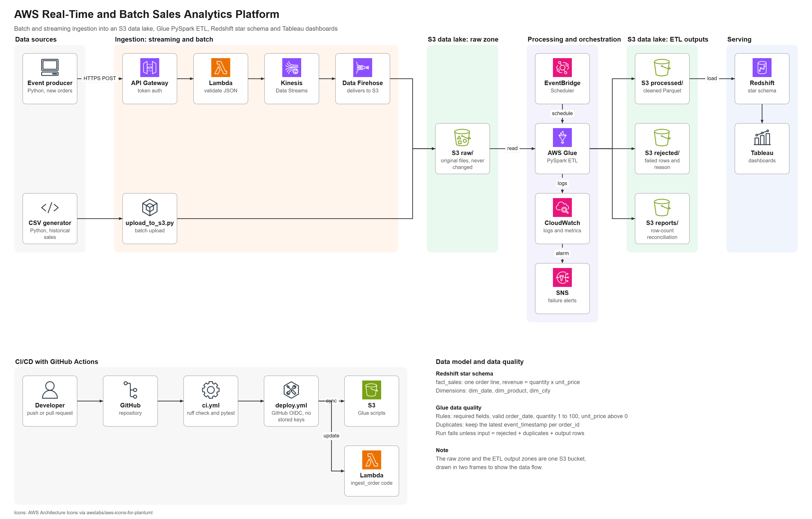

# Architecture

## System diagram

[](images/architecture.png)

The diagram shows the batch path, the streaming path, the S3 data lake, Glue processing and orchestration, the Redshift star schema with Tableau, and the CI/CD pipeline. The raw zone and the ETL output zones are one S3 bucket, drawn in two frames so the data flow reads left to right. Service icons are from the AWS Architecture Icons. An earlier reference design is kept in [images/reference-architecture.jpg](images/reference-architecture.jpg).

## Goals

1. Keep every original record (raw zone in S3) so any transformation can be re-run.
2. Make bad data visible instead of silently dropping it (rejected zone + run reports).
3. Re-running a batch must never double-count sales (idempotent writes and loads).
4. Keep cost low: serverless where possible, expensive services only when needed.

## Batch flow

```
generate_data.py ──► upload_to_s3.py ──► s3://bucket/raw/sales/ingestion_date=D/
                                                   │
                     EventBridge Scheduler ──► Glue job transform_sales.py
                                                   │
                ┌──────────────────────────────────┼─────────────────────────────┐
                ▼                                  ▼                             ▼
   processed/sales/year=/month= (Parquet)   rejected/sales/ingestion_date=D   reports/sales/ingestion_date=D
                │
                ▼
     Redshift stg_sales ──MERGE on order_id──► fact_sales (+ dims) ──► Tableau
```

### Glue job steps

1. Read the CSV for one `ingestion_date` with every column as a string.
2. Parse types (`order_date` → date, `quantity` → int, `unit_price` → decimal).
3. Build a `rejection_reason` per row from the validation rules. Rows with a reason go to `rejected/`.
4. De-duplicate valid rows by `order_id`, keeping the latest `event_timestamp`.
5. Compute `revenue = quantity × unit_price`.
6. Write Parquet partitioned by `year`/`month` with **dynamic partition overwrite** (idempotent).
7. Write a JSON report and fail the job if `input = rejected + duplicates + output` does not hold.

### Why Parquet

Columnar, compressed, typed. Redshift COPY / Spectrum and Athena read far less data than CSV.

## Streaming flow

```
producer.py ──HTTPS POST (JSON body, bearer token)──► API Gateway
                                                         │ authorizer
                                                         ▼
                                              Lambda ingest_order
                                    (content-type check, JSON parse, validate)
                                         │ 400/415 on bad input
                                         ▼
                              Kinesis Data Streams (partition key = order_id)
                                         ▼
                              Amazon Data Firehose (buffer → S3)
                                         ▼
                              s3://bucket/raw/streaming/YYYY/MM/DD/HH/
                                         ▼
                              Glue job (same rules) → processed/ → Redshift (source='stream')
```

Kinesis and Firehose can deliver a record more than once. `order_id` is the dedupe key, so
the Glue de-duplication and the Redshift MERGE absorb repeats.

## Security

| Area | Decision |
|------|----------|
| Account | MFA on root; root only for account admin; day-to-day work via IAM Identity Center or an IAM user with MFA |
| S3 | Block Public Access on, default encryption on, bucket policy denies non-TLS requests |
| IAM | One role per component (Glue, Lambda, Firehose, Redshift), scoped to named resources |
| API | Token auth at API Gateway; only JSON bodies accepted; throttling enabled |
| Network | One VPC; Redshift in private subnets, not publicly accessible |
| Secrets | Never in Git. Local: AWS CLI profiles. CI/CD: GitHub OIDC role. Runtime: Secrets Manager |

## Monitoring

- Glue and Lambda logs in CloudWatch Logs.
- CloudWatch alarms on Glue job failure, Lambda errors/throttles, Kinesis iterator age.
- SNS email notification on alarm.
- Daily data-quality numbers from `reports/`.

## Open decisions

- Glue trigger: schedule only vs. S3 event + schedule (avoid one job per tiny file).
- Redshift: Serverless vs. a small provisioned cluster — decide after checking current pricing.
- IaC tool for Phase 7: Terraform vs. AWS CDK vs. CloudFormation.
